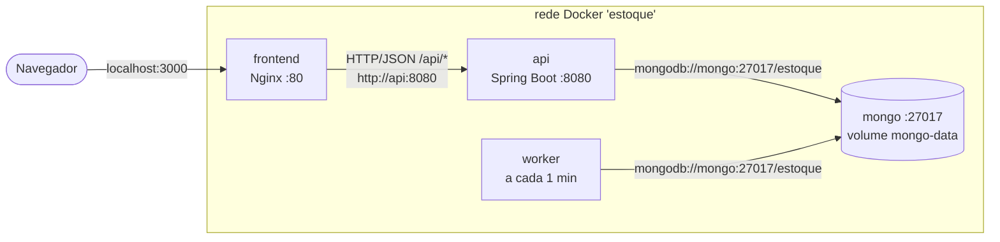
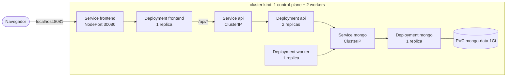

# Sistema de Estoque e Vendas

**Tema 3 – Estoque e vendas de um pequeno comercio.**

O dono de uma padaria ou mercadinho anota as vendas em caderno e so descobre que um produto acabou
quando o cliente pede. Este sistema registra produtos, entradas de mercadoria e vendas, nao deixa
vender o que nao tem em estoque e, a cada minuto, um processo automatico (Worker) monta a lista de
produtos que precisam de reposicao.

| Servico | Tecnologia | Pasta | Responsavel |
|---|---|---|---|
| Frontend | React + TypeScript (Vite), servido por Nginx | [`frontend/`](frontend) | Pessoa 1 |
| API | Java 21 + Spring Boot 3.5 | [`api/`](api) | Pessoa 2 |
| Worker | Java 21 + Spring Boot 3.5 (`@Scheduled`) | [`worker/`](worker) | Pessoa 3 |
| Banco | MongoDB 7 (imagem oficial) | – | – |
| Infra | Docker, Docker Compose, Kubernetes (kind) | [`k8s/`](k8s), [`docs/DEVOPS.md`](docs/DEVOPS.md) | Pessoa 4 |

## Funcionalidades

- Cadastro, edicao, busca e remocao de **produtos** (nome, preco, quantidade em estoque, estoque minimo).
- Cadastro de **fornecedores**.
- **Entrada de mercadoria**: soma ao estoque e guarda o historico (com fornecedor).
- **Venda** de um ou mais produtos: o total e calculado pela API com o preco do cadastro e o estoque e reduzido.
  **A venda e recusada se nao houver quantidade suficiente** (nada e baixado).
- **Historico de vendas** e **faturamento total**.
- **Relatorio**: quantidade de vendas, faturamento total, ticket medio, faturamento por dia e por forma de pagamento, produtos mais vendidos.
- **Worker (a cada minuto)**: encontra os produtos com estoque igual a zero e registra a lista de reposicao.
  Quando chega mercadoria, a API marca a reposicao como resolvida.
- **Dados de exemplo** (R3): `POST /api/dados-exemplo?limpar=true`.

## Arquitetura

### Docker Compose



### Kubernetes (namespace `estoque`)



Como os containers se comunicam:

- O **navegador** fala **apenas com o frontend**. O Nginx do frontend entrega as telas e repassa
  tudo o que comeca com `/api/` para o servico `api` (HTTP + JSON). Assim o navegador nunca acessa a API diretamente.
- A **API** e o **Worker** acessam o MongoDB pelo **nome do servico**: `mongodb://mongo:27017/estoque`.
- O **MongoDB nao e exposto**: no Compose ele nao publica porta; no Kubernetes o Service e `ClusterIP`.
- O **Worker** nao recebe chamadas: ele mesmo roda a verificacao a cada minuto e grava no banco.
  A API le o que ele gravou (`reposicao`) e mostra no frontend.

## Colecoes do MongoDB (database `estoque`)

Valores em dinheiro sao gravados como `Decimal128`. Datas em UTC.

**`produtos`** – escrita pela API, lida pelo Worker

| Campo | Tipo | Descricao |
|---|---|---|
| `_id` | ObjectId | |
| `codigo` | string (unico, opcional) | Codigo/SKU |
| `nome` | string | |
| `descricao`, `categoria` | string | Opcionais |
| `precoVenda` | Decimal128 | Preco usado nas vendas |
| `precoCusto` | Decimal128 | Opcional |
| `quantidadeEstoque` | int | So muda por entradas e vendas |
| `estoqueMinimo` | int | Abaixo disso o produto aparece como "estoque baixo" |
| `ativo` | bool | Remocao logica |
| `criadoEm`, `atualizadoEm` | date | |

**`fornecedores`** – API

| Campo | Tipo | Descricao |
|---|---|---|
| `_id` | ObjectId | |
| `nome` | string | |
| `nomeBusca` | string (unico) | Nome em minusculas, evita duplicados |
| `cnpj`, `telefone`, `email` | string | Opcionais |
| `ativo` | bool | |
| `criadoEm`, `atualizadoEm` | date | |

**`entradas`** – API (entradas de mercadoria)

| Campo | Tipo | Descricao |
|---|---|---|
| `_id` | ObjectId | |
| `produtoId`, `produtoNome` | string | |
| `quantidade` | int | |
| `custoUnitario` | Decimal128 | Opcional |
| `fornecedorId`, `fornecedor` | string | Referencia e nome do fornecedor |
| `observacao` | string | |
| `estoqueResultante` | int | Estoque logo apos a entrada |
| `dataEntrada` | date | |

**`vendas`** – API (lida pelo Worker)

| Campo | Tipo | Descricao |
|---|---|---|
| `_id` | ObjectId | |
| `itens[]` | array | `produtoId`, `produtoNome`, `quantidade`, `precoUnitario`, `subtotal` (nome e preco do momento da venda) |
| `valorTotal` | Decimal128 | Soma dos subtotais |
| `quantidadeItens` | int | Soma das quantidades |
| `formaPagamento` | string | `DINHEIRO`, `PIX`, `CARTAO_DEBITO`, `CARTAO_CREDITO` |
| `cliente` | string | Opcional |
| `dataVenda` | date | |

**`reposicao`** – criada pelo Worker, resolvida pela API

| Campo | Tipo | Descricao |
|---|---|---|
| `_id` | ObjectId | |
| `produtoId`, `produtoNome` | string | |
| `quantidadeAtual` | int | Estoque quando foi registrada |
| `status` | string | `PENDENTE` (Worker) → `RESOLVIDA` (API, ao registrar entrada) |
| `dataRegistro`, `dataResolucao` | date | |

**`relatorios`** – Worker (documento `_id: "resumo-geral"`, recalculado a cada minuto)

| Campo | Tipo |
|---|---|
| `quantidadeVendas`, `quantidadeItensVendidos`, `totalProdutosAtivos`, `produtosSemEstoque`, `reposicoesPendentes` | long |
| `faturamentoTotal`, `ticketMedio` | Decimal128 |
| `produtosParaRepor[]` | `produtoId`, `produtoNome`, `quantidadeAtual` |
| `atualizadoEm` | date |

## Como rodar com Docker

Requisitos: **somente Docker e Docker Compose**.

```powershell
git clone https://github.com/ThaigoDev/projeto-gestao-estoque-devops.git
cd projeto-gestao-estoque-devops
docker compose up -d --build
```

Espere uns 30 segundos ate a API subir e carregue os dados de exemplo (apaga o que houver no banco):

```powershell
Invoke-RestMethod -Method Post "http://localhost:3000/api/dados-exemplo?limpar=true"
# Linux/macOS: curl -X POST "http://localhost:3000/api/dados-exemplo?limpar=true"
```

- Sistema: **http://localhost:3000**
- API: http://localhost:8080/api/info

```powershell
docker compose ps                 # estado dos servicos
docker compose logs -f worker     # Worker: uma linha por minuto
docker compose down               # para tudo (mantem os dados)
docker compose down -v            # para tudo e apaga o banco
```

Teste de persistencia (D3): veja [docs/DEVOPS.md](docs/DEVOPS.md#d3--dados-permanecem-apos-recriar-o-container-do-banco).

## Imagens no Docker Hub (v1)

- `lucashc1011/estoque-api:v1`
- `lucashc1011/estoque-frontend:v1`
- `lucashc1011/estoque-worker:v1`

Para gerar e publicar: `.\scripts\publicar-imagens.ps1 -Usuario lucashc1011 -Versao v1` (depois de `docker login`).

## Como subir no cluster Kubernetes

Requisitos: Docker, `kubectl` e `kind` (`winget install Kubernetes.kind`).

```powershell
kind create cluster --name estoque --config k8s/kind-cluster.yaml   # 1 control-plane + 2 workers
kubectl get nodes
kubectl apply -k k8s
kubectl -n estoque get pods -o wide -w                              # espere tudo Running
Invoke-RestMethod -Method Post "http://localhost:8081/api/dados-exemplo?limpar=true"
```

Sistema no cluster: **http://localhost:8081**.

| Servico | Replicas | Service |
|---|---|---|
| frontend | 1 | NodePort 30080 (acessivel pelo navegador) |
| api | 2 | ClusterIP (so dentro do cluster) |
| mongo | 1 + PVC 1Gi | ClusterIP (so dentro do cluster) |
| worker | **exatamente 1** | ClusterIP (so `/status` e health) |

**Por que o Worker usa so uma replica?** Ele nao atende requisicoes; e uma tarefa agendada que roda
a cada minuto. Com duas replicas a mesma verificacao rodaria duas vezes, em paralelo, e as duas
poderiam registrar a mesma reposicao em duplicidade. Mais replicas nao trariam ganho, so trabalho repetido.

## Comandos dos testes no cluster

Detalhes e explicacao de cada passo em [docs/DEVOPS.md](docs/DEVOPS.md#4-demonstracoes).

Monitor (deixe rodando para mostrar que o sistema continua respondendo):

```powershell
while ($true) { try { $i = Invoke-RestMethod http://localhost:8081/api/info -TimeoutSec 2; "$(Get-Date -f HH:mm:ss)  $($i.versao)  $($i.instancia)" } catch { "$(Get-Date -f HH:mm:ss)  FALHOU" }; Start-Sleep 1 }
```

**K5 – Falha da API**
```powershell
kubectl -n estoque get pods -l app=api
kubectl -n estoque delete pod <pod-da-api>
kubectl -n estoque get pods -l app=api
```

**K6 – Persistencia do banco**
```powershell
kubectl -n estoque exec deploy/mongo -- mongosh estoque --quiet --eval "db.produtos.countDocuments()"
kubectl -n estoque delete pod -l app=mongo
kubectl -n estoque get pods -l app=mongo -w
kubectl -n estoque exec deploy/mongo -- mongosh estoque --quiet --eval "db.produtos.countDocuments()"
```

**K7 – Escala (2 → 3 → 2)**
```powershell
kubectl -n estoque scale deployment/api --replicas=3
kubectl -n estoque get pods -l app=api
kubectl -n estoque scale deployment/api --replicas=2
kubectl -n estoque get pods -l app=api
```

**K8 – Atualizacao v1 → v2 e retorno para v1**
```powershell
.\scripts\publicar-imagens.ps1 -Usuario lucashc1011 -Versao v2 -Servicos api,frontend
kubectl -n estoque set image deployment/api api=lucashc1011/estoque-api:v2
kubectl -n estoque set image deployment/frontend frontend=lucashc1011/estoque-frontend:v2
kubectl -n estoque rollout status deployment/api
# rodape do site e /api/info mostram "v2"; o monitor nao mostra FALHOU (rolling update)
kubectl -n estoque rollout undo deployment/api
kubectl -n estoque rollout undo deployment/frontend
```

## Estrutura do repositorio

```
.
├── frontend/            # React + Nginx (Dockerfile)
├── api/                 # Spring Boot (Dockerfile) - endpoints em api/README.md
├── worker/              # Spring Boot agendado (Dockerfile)
├── k8s/                 # Namespace, Deployments, Services, PVC, cluster kind, kustomization
├── scripts/             # publicar imagens no Docker Hub
├── docs/DEVOPS.md       # passo a passo detalhado de Docker e Kubernetes
└── docker-compose.yml
```

Documentacao de cada servico: [frontend](frontend/README.md) · [api](api/README.md) · [worker](worker/README.md).
